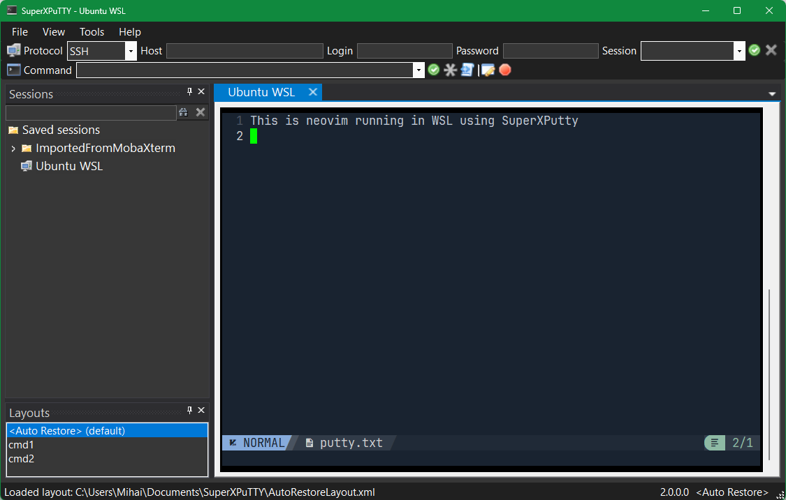

# SuperXPuTTY Terminal Manager

SuperXPuTTY is a Windows application which manages PuTTY/KiTTY terminals. It supports multiple protocol types such as RDP, VNC, serial, SSH, Telnet by using third party apps.

This repository is a fork of jimradford's SuperPuTTY which aims to fix some old issues and improve the overall quality of life.

## Latest release

  

All releases are available for download at https://github.com/SilverGreen93/superputty/releases

Documentation is available at https://github.com/jimradford/superputty/wiki/Documentation

**Note!** PuTTY is mandatory for the application to work. The recommended version of PuTTY is [PuTTY Plus](https://github.com/SilverGreen93/putty/), which adds some more extra-features to the experience.

## Features

- Dark theme (2 variants), using [Dark Mode Forms](https://github.com/BlueMystical/Dark-Mode-Forms).
- Supports protocols: Telnet, Rlogin, VNC, SSH, Serial, RDP, MinTTY, WSL, CMD, PS
- Start/stop X11 server right from the applicaton.
- Support for Windows Subsystem for Linux hosts.
- Quickly connect to hosts using the connect bar.
- Quickly send commands to all terminals.
- Save and restore different layouts.
- Import existing sessions from various software such as MobaXterm.
- Snappy tabbed interface based on VS2015 interface.
- Simple scripting language for basic tasks.
- Lots of bugs fixed and quality of life features added compared to the original SuperPutty.

## Building and issue tracking

The project was built with Visual Studio 2026.

To request new features or report any found issues, use the Issues tab.

## License

MIT

For additional License information please read the License.txt included with the download
